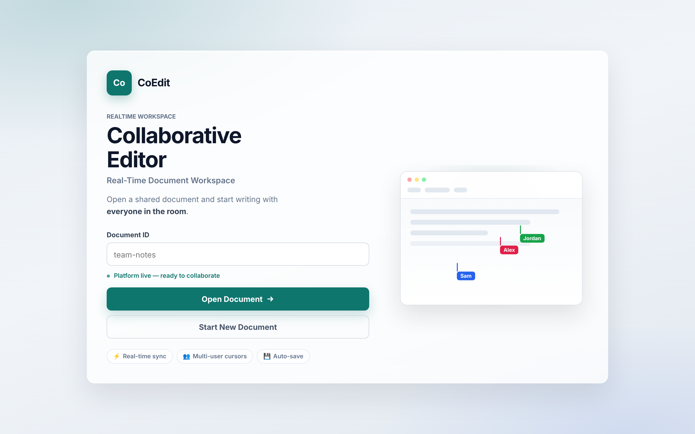
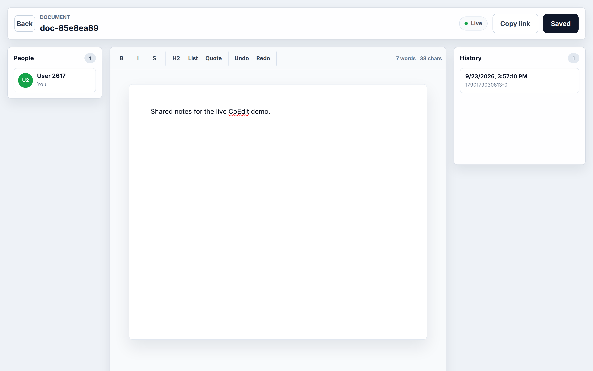
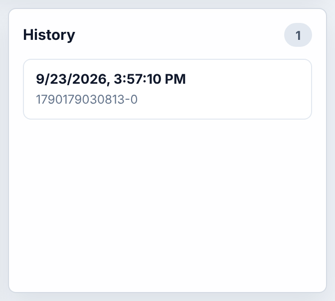

# CoEdit



A shared editor in the spirit of Google Docs. Open the same document in two windows and type in both.

Live: https://collaborative-real-time-document-ed.vercel.app, talking to the API at https://crde-backend.onrender.com ([health](https://crde-backend.onrender.com/api/health), [docs](https://crde-backend.onrender.com/docs)). The API is on Render's free tier, so the first request after a while can be slow. The old `frontend-sable-kappa-64.vercel.app` link is dead.

There are no accounts. Your name and cursor color live in the browser. You can start a document or open one by ID, see who else is in it and follow their cursors, and use bold, italic, strikethrough, headings, lists, quotes, undo and redo. The toolbar counts words and characters. You can save a snapshot and preview it later, but snapshots don't get restored into the live doc. Recent document IDs are kept in the browser, and there's a copy-link button and a connection indicator (live, connecting, reconnecting, offline).



## How it works

```txt
React + TipTap + Yjs
        |
        | WebSocket  /ws/docs/{doc_id}
        v
FastAPI realtime server
        |
        | Redis streams + pub/sub
        v
Redis
```

TipTap is bound to a Yjs document. Updates and presence go over a WebSocket to FastAPI, which broadcasts them to everyone on that process, appends them to a Redis stream, and publishes them so other server instances can fan out too. Snapshots sit in a second stream and come back over REST: `GET /api/health`, `GET /api/docs/{doc_id}/history`, `GET /api/docs/{doc_id}/snapshot/{snapshot_id}`.



## Run it

```bash
docker compose up --build
```

Frontend on http://localhost:5173, backend on http://localhost:8000 (docs at `/docs`), Redis on 6379. Stop with `docker compose down`.

Without Docker you need Node 22 (or 20.19+), Python 3.12 and Redis 7 on `localhost:6379`. On Windows, run Redis in WSL.

```bash
cd backend
python -m venv .venv && source .venv/bin/activate   # PowerShell: .\.venv\Scripts\Activate.ps1
pip install -r requirements.txt
uvicorn app.main:app --reload --host 0.0.0.0 --port 8000

cd frontend && npm install && npm run dev
```

| Variable | Where | Default |
| --- | --- | --- |
| `VITE_API_BASE_URL` | frontend | `http://localhost:8000` |
| `VITE_WS_BASE_URL` | frontend | API URL with `ws`. Use `wss://` in production. |
| `REDIS_URL` | backend | `redis://localhost:6379/0` |
| `CORS_ORIGINS` | backend | `http://localhost:5173,http://127.0.0.1:5173` |
| `UPDATES_MAXLEN` | backend | `20000` updates per doc |
| `SNAPSHOTS_MAXLEN` | backend | `200` snapshots per doc |

`VITE_*` values are read at startup, so restart or rebuild after changing them.

## Deploying

`render.yaml` sets up a free Key Value instance (`crde-redis`) and the Python service (`crde-backend`, root `backend`, health check `/api/health`, start command `uvicorn app.main:app --host 0.0.0.0 --port $PORT`). It pins Python 3.12.0, wires `REDIS_URL`, and sets `CORS_ORIGINS` to the Vercel origin plus local Vite. Manual deploy:

```bash
render deploys create srv-d92c43po3t8c73bb1c9g --confirm
```

For the frontend, deploy `frontend/` to Vercel with:

```txt
VITE_API_BASE_URL=https://crde-backend.onrender.com
VITE_WS_BASE_URL=wss://crde-backend.onrender.com
```

Add the new origin to `CORS_ORIGINS` on Render first. Once linked, `npx vercel deploy --prod` from `frontend/` does it.

[MIT](LICENSE)
